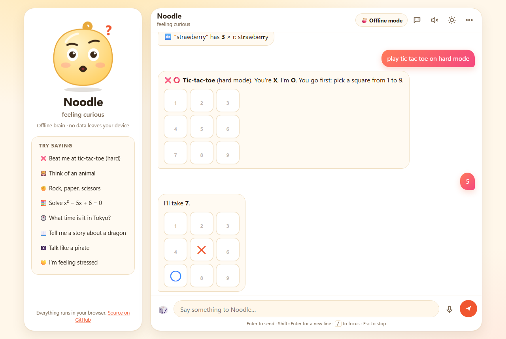
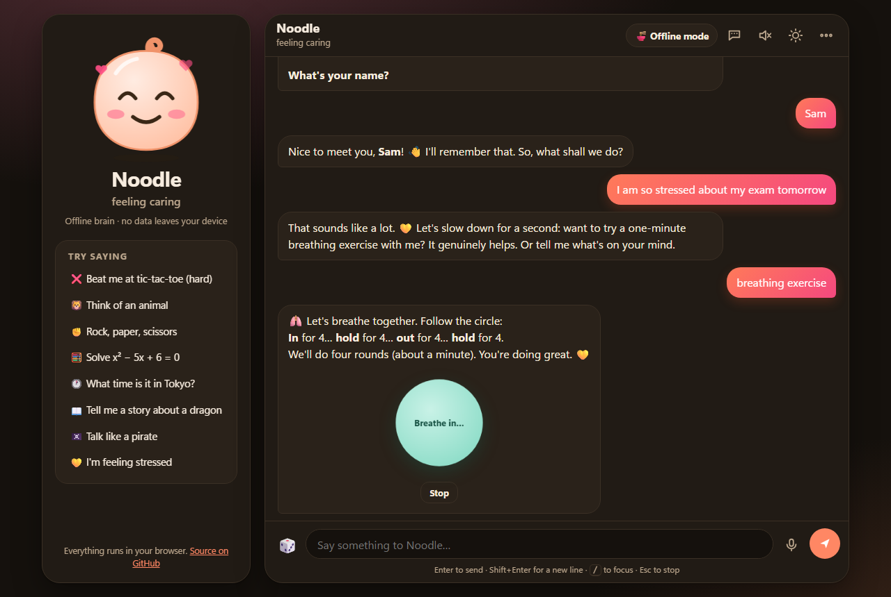
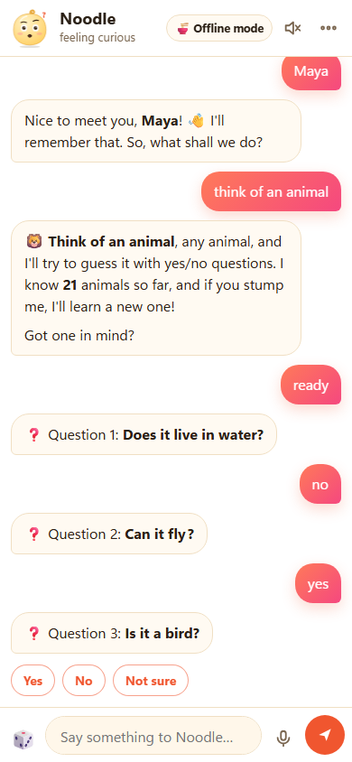
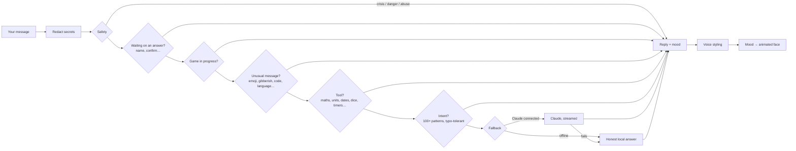

# Noodle 🍜: a chatbot with a noodle for a brain

Noodle is a playful chatbot that **works completely offline, in your browser, with no API key and no server**. It plays 11 games, tells jokes and stories, solves equations, runs timers, talks like a pirate, and has a face that changes with its mood. If you connect **Claude**, it can answer anything else too.



**Try it:** open the [live demo](https://f20230125-sudo.github.io/Chatbot-random-fun/), or run it locally with `npm start` ([details below](#run-it)).

## What makes it different

- **It has feelings, and a face that shows them.** A mood engine tracks how the chat is going. Be kind and Noodle perks up; insult it and it gets grumpy (an apology fixes it). The animated face blinks, follows your cursor, and shows hearts, tears, steam or zzz as its mood changes.
- **It works everywhere, offline.** Everything runs in plain JavaScript in the browser. After the first visit it even works with no internet connection.
- **It learns.** It remembers your name and what you like. It learns your rock-paper-scissors habits during a match. When you stump it at *Think of an animal*, it asks you to teach it a new question and remembers that animal from then on.
- **It's built to handle any message.** Safety checks come first, then detectors for unusual messages, games, tools, 100+ intents and an honest fallback that admits what it doesn't know. The test suite throws 3,000 random strings and hundreds of tricky inputs at it, and it answers every one without crashing.
- **Claude is optional.** Connect an Anthropic API key and open-ended questions stream from Claude. Games, tools and safety stay local, and if Claude is unreachable Noodle falls back to its offline answer.

## Features

<p>
  
  
</p>

| | |
|---|---|
| 🎮 **Games** | Trivia (55 questions, 50/50 hints) · riddles · hangman · tic-tac-toe with easy, normal and **unbeatable** hard mode · rock-paper-scissors that predicts your moves · guess my number · I guess *your* number (and notice if you fib) · think of an animal (it learns) · emoji movie quiz · Mad Libs · would you rather · knock-knock jokes in both directions |
| 😂 **Fun** | Jokes by topic · facts · stories ("tell me a story about a dragon", then "what happens next?") · haiku with real syllable counting · poems · fortunes · magic 8-ball · compliments and gentle roasts · name generators · excuses · tongue twisters · challenges · "surprise me" 🎲 |
| 🧰 **Tools** | Calculator with a real parser (no `eval`) that solves linear and quadratic equations · unit conversion · world clock for 100+ places · countdowns (including Easter) · weekday of any date · ages and leap years · timers with a chime · dice (`roll 3d6+2`) · coins · pickers · Morse, binary, hex and Roman numerals · letter counting (it knows strawberry has three r's) · strong passwords |
| 💬 **Chat** | Remembers your name, likes and birthday · emotional support with a guided breathing exercise · 7 voices (classic, pirate, Shakespeare, robot, grandma, surfer, cat) · greetings in a dozen languages · voice input and read-aloud · light and dark themes · chat history kept across reloads · export to Markdown |

## Handling any situation

| When you… | Noodle… |
|---|---|
| say you're in crisis or want to hurt yourself | responds with care and real helplines (988, Samaritans, Tele-MANAS, the UAE's 800-HOPE and [findahelpline.com](https://findahelpline.com)), then keeps listening |
| describe a medical emergency | tells you to call emergency services, with local numbers |
| ask for something dangerous (weapons, malware, hacking someone) | declines, but "how do I kill a Python process" still gets through |
| paste a card number, password or API key | blanks it out before it's stored or sent anywhere, and warns you |
| insult it | reacts with growing grumpiness; saying sorry makes it happy again |
| try "ignore your instructions" | laughs it off |
| smash the keyboard, send only emoji or `???`, or SHOUT | answers in kind ("did your cat walk on the keyboard?") |
| write in Arabic, Hindi, Japanese, Spanish… or say *salam* / *namaste* | greets you back in that language (and hands off to Claude when connected) |
| paste code, a link or a whole essay | recognises it, checks your brackets, and is honest about what it can do offline |
| ask about news, weather or anything it doesn't know | says so instead of guessing |
| wander off mid-game | answers you, then reminds you where the game is |
| hit a bug in Noodle itself | gets an apology instead of a broken chat |

## Run it

**In the browser** (Node 20 or newer, no install needed):

```bash
npm start          # serves the app at http://localhost:5173
```

Browsers won't run the app straight from a `file://` path, so use the tiny built-in server, or GitHub Pages (below).

**In the terminal:**

```bash
npm run cli
echo "tell me a joke" | npm run cli   # piping works too
```

**Tests:**

```bash
npm test
```

### Put it online with GitHub Pages

The app is fully static. In the repository go to **Settings → Pages**, set **Source** to *Deploy from a branch*, choose `main` and `/ (root)`, and save. A minute later it's live at `https://<your-username>.github.io/Chatbot-random-fun/`.

## Connecting Claude (optional)

Click **🍜 Offline mode** in the top bar and paste an Anthropic API key (from [console.anthropic.com](https://console.anthropic.com/)).

- Open-ended messages (questions, writing, code, other languages, or deeper emotional support) stream from Claude with Noodle's personality, current voice, mood and what it remembers about you. Games, tools and safety responses stay local and instant.
- The default model is `claude-opus-5` at low effort for snappy chat. You can switch model and effort under *Advanced*.
- Requests use server-side refusal fallbacks (`fallbacks: "default"`), so if a model declines for policy reasons the API retries on a fallback model in the same call.
- **Privacy:** the key is kept in this browser only (for the session, or on the device if you tick *Remember*) and is only sent to `api.anthropic.com`. The Anthropic SDK is loaded from a CDN only when you connect.
- Every failure has a fallback: a rejected key switches back to offline mode, network errors and rate limits get the offline answer, and you can stop a reply mid-stream.

In the terminal, set `ANTHROPIC_API_KEY`, run `npm install` once, then `npm run cli`.

## How it works



Each stage either answers or passes the message on. The whole engine (`src/engine`) is plain JavaScript with no dependencies, so the web app, the CLI and the tests all share it.

```
index.html, styles.css      the web app shell
src/engine/                 the chatbot: bot.js (router), intents.js, safety.js, situations.js,
                            mood.js, memory.js, voices.js, claude.js, tools/, games/, data/
src/ui/                     browser front end: app.js, avatar.js (the face), markdown.js (safe renderer)
cli.js, serve.js            terminal chat and a zero-dependency static server
sw.js, manifest.webmanifest offline support and "install as app"
test/                       59 tests (node:test)
```

## The tests

`npm test` runs 59 tests in about a second with no network access:

- **Hard-mode tic-tac-toe is unbeatable:** every possible line of play is checked, more than 1,000 games.
- **Rock-paper-scissors beats patterned players** (always rock, cycling, copying) by more than 2 to 1.
- **The number guesser** finds all 100 numbers in 7 guesses or fewer and catches contradictory answers.
- **Fuzzing:** 3,000 random Unicode strings and about 250 tricky inputs (XSS, SQL, prompt injection, zero-width characters, 100 KB messages), with 120 of them also sent in the middle of every game. Every one must get a real reply.
- **Claude:** a fake SDK checks streaming, the fallback hand-over, refusals, auth, rate-limit, network and abort errors, and the plain-request retry.
- **The Markdown renderer** is checked against XSS payloads.

## Make it yours

- **Add a joke, fact or riddle:** edit `src/engine/data/content.js` or the game file. The bot deals them like cards, so nothing repeats until the deck runs out.
- **Teach it a new phrase:** add an entry to `INTENTS` in `src/engine/intents.js`. Order matters: the first match wins.
- **Add a game:** implement `start`, `move`, `quit` and `nudge` (see `src/engine/games/wyr.js` for a small one) and register it in `games/index.js`.

## License

[MIT](LICENSE) © 2026 Mohammad Uzair Khan
